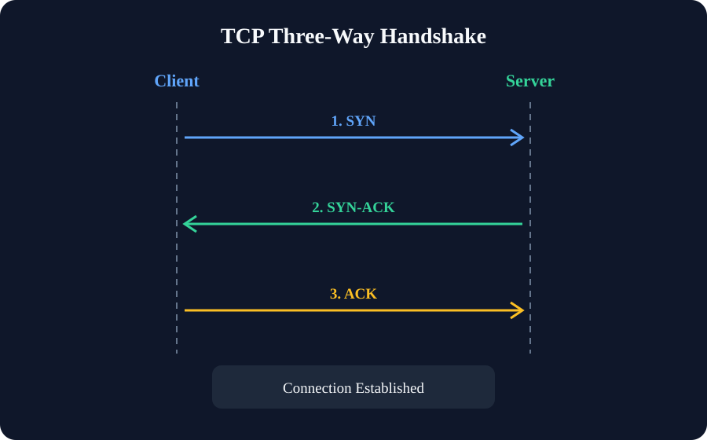
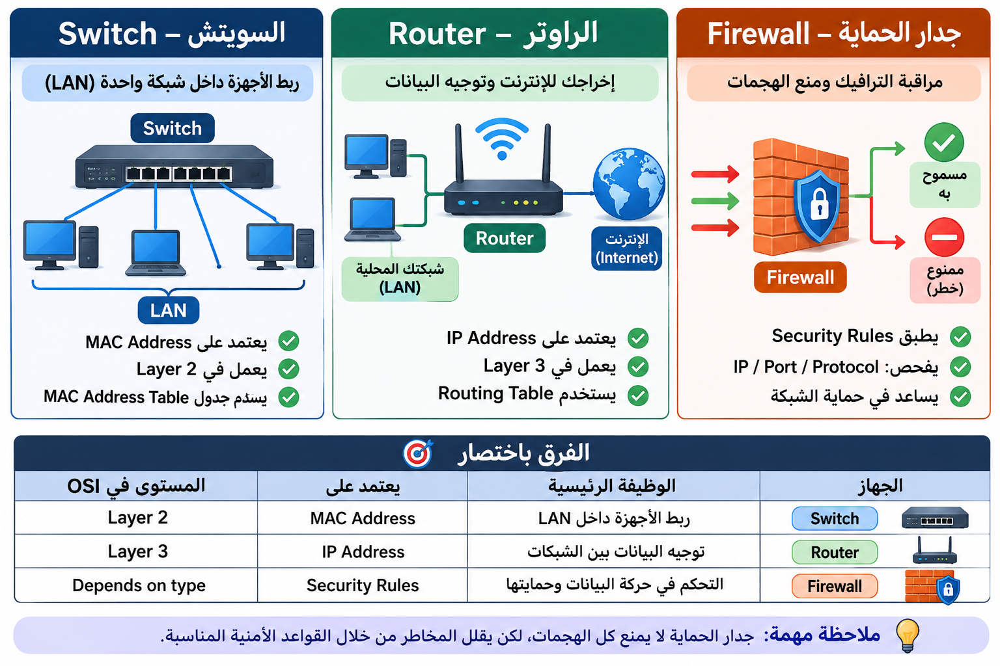

# Networking Diagnostic Test

**Date:** 2026-11-08

**Purpose:** Evaluate my networking knowledge from memory without external resources.

## 1. TCP vs UDP

### TCP

مناسب لنقل البيانات التي تحتاج إلى وصول موثوق، مع التأكد من وصول البيانات بالترتيب الصحيح، مثل نقل الملفات.

### UDP

مناسب للتطبيقات التي تحتاج إلى سرعة وتقليل التأخير، مثل البث المباشر والمكالمات الصوتية والمرئية.

### TCP Three-Way Handshake

هي عملية إنشاء اتصال بين جهازين باستخدام بروتوكول TCP، وتتكون من ثلاث مراحل:

**المرحلة الأولى — SYN**

يرسل جهاز العميل (Client) طلبًا إلى الخادم (Server) لبدء الاتصال.

**المرحلة الثانية — SYN-ACK**

يرد الخادم بالموافقة على الاتصال، ويؤكد استلام طلب العميل.

**المرحلة الثالثة — ACK**

يرسل جهاز العميل تأكيدًا باستلام رد الخادم، وبذلك يصبح الاتصال جاهزًا لنقل البيانات.

## 2. Common Ports

| Port | Protocol / Service | Purpose |
|---|---|---|
| 22 | SSH |اتصال آمن بجهاز آخر والتحكم فيه عن بُعد |
| 53 | DNS | تحويل أسماء النطاقات إلى عناوين IP لتسهيل الوصول إلى المواقع والخدمات |
| 80 | HTTP | تبادل طلبات واستجابات الويب بين المتصفح والخادم دون تشفير افتراضيًا |
| 443 | HTTPS | تبادل بيانات الويب بشكل مشفر باستخدام TLS لحماية الاتصال |
| 445 | SMB | مشاركة الملفات والمجلدات والطابعات بين الأجهزة عبر الشبكة، خاصة في Windows |
| 3389 | RDP | التحكم في أجهزة Windows عن بُعد من خلال واجهة رسومية |
## 3. DNS Records (سجلات DNS)

سجلات DNS هي معلومات بتحدد إزاي الدومين يتعامل مع خدمات الإنترنت المختلفة.

- **A (Address Record):**
  - بيربط اسم الدومين بعنوان IP من نوع IPv4.
  - مثال: `example.com → 192.168.1.10`

- **MX (Mail Exchange Record):**
  - بيحدد سيرفر البريد الإلكتروني المسؤول عن استقبال الرسائل الخاصة بالدومين.
  - مثال: `example.com → mail.example.com`

- **TXT (Text Record):**
  - بيخزن معلومات نصية مرتبطة بالدومين.
  - من استخداماته:
    - SPF: تحديد السيرفرات المسموح لها بإرسال الإيميلات باسم الدومين.
    - DKIM: التحقق من صحة توقيع البريد الإلكتروني.
    - DMARC: تحديد سياسة التعامل مع رسائل البريد غير الموثوقة.
    - Domain Verification: التحقق من ملكية الدومين.

- **PTR (Pointer Record):**
  - بيربط عنوان IP باسم الدومين.
  - بيُستخدم في Reverse DNS Lookup.
  - مثال: `192.168.1.10 → example.com`

### Quick Comparison (مقارنة سريعة)

| Record | الوظيفة |
|---|---|
| A | Domain → IPv4 |
| MX | تحديد Mail Server |
| TXT | تخزين معلومات نصية |
| PTR | IP → Domain (Reverse DNS) |

## 4. ARP and NAT

### ARP (Address Resolution Protocol)

- بروتوكول بيستخدم لمعرفة MAC Address الخاص بجهاز عن طريق معرفة IP Address بتاعه داخل الشبكة المحلية (LAN).

### How ARP Works

1. **ARP Request:** الجهاز بيرسل Broadcast بيسأل مين صاحب الـ IP المطلوب؟
2. **ARP Reply:** الجهاز صاحب الـ IP بيرد بعنوان MAC Address الخاص به.
3. **ARP Cache:** الجهاز بيخزن العلاقة بين IP وMAC مؤقتًا لتقليل تكرار الطلبات.

### NAT (Network Address Translation)

- تقنية بتسمح للراوتر بتغيير عناوين IP أثناء انتقال البيانات بين الشبكة الداخلية والإنترنت.
- بتحوّل Private IP إلى Public IP عند خروج البيانات للإنترنت، والعكس عند رجوع الرد.

### Why NAT Is Used?

- **IP Address Conservation:** توفير عناوين IPv4 العامة.
- **Multiple Devices:** السماح لأجهزة متعددة باستخدام Public IP واحد عن طريق PAT.
- **Private Network:** استخدام Private IPs داخل الشبكة بدلًا من تخصيص Public IP لكل جهاز.

**Note:** NAT helps reduce the need for public IPv4 addresses, while IPv6 provides a much larger address space to solve IPv4 address exhaustion.

## 5. Network Devices (أجهزة الشبكات)

### 1. Switch (السويتش)

- بيستخدم لربط الأجهزة داخل شبكة محلية (LAN).
- بيعتمد على MAC Address لتحديد الأجهزة وإرسال البيانات إليها.
- بيشتغل بشكل أساسي في Layer 2 (Data Link Layer).
- بيستخدم جدول MAC Address Table لمعرفة الأجهزة المتصلة بكل Port.

### 2. Router (الراوتر)

- بيستخدم لربط شبكات مختلفة ببعض وتوجيه البيانات بينها.
- بيعتمد على IP Address لتحديد وجهة البيانات.
- بيشتغل بشكل أساسي في Layer 3 (Network Layer).
- بيستخدم Routing Table لاختيار المسار المناسب.
- ممكن يربط الشبكة المحلية (LAN) بالإنترنت (WAN).

### 3. Firewall (جدار الحماية)

- جهاز أو برنامج بيستخدم لمراقبة والتحكم في Network Traffic.
- بيسمح أو يمنع الاتصالات بناءً على Security Rules.
- ممكن يعتمد على:
  - Source IP Address
  - Destination IP Address
  - Port Number
  - Protocol (TCP/UDP)
  - Connection State
- بيساعد في حماية الشبكة من الاتصالات غير المصرح بها.

### 4. Quick Comparison

| Device | Main Function | Layer |
|---|---|---|
| Switch | Connecting devices within a LAN | Layer 2 |
| Router | Routing traffic between networks | Layer 3 |
| Firewall | Filtering and controlling network traffic | Depends on type |

**Note:** A Firewall does not prevent all attacks. Its effectiveness depends on its type, configuration, and security rules.

