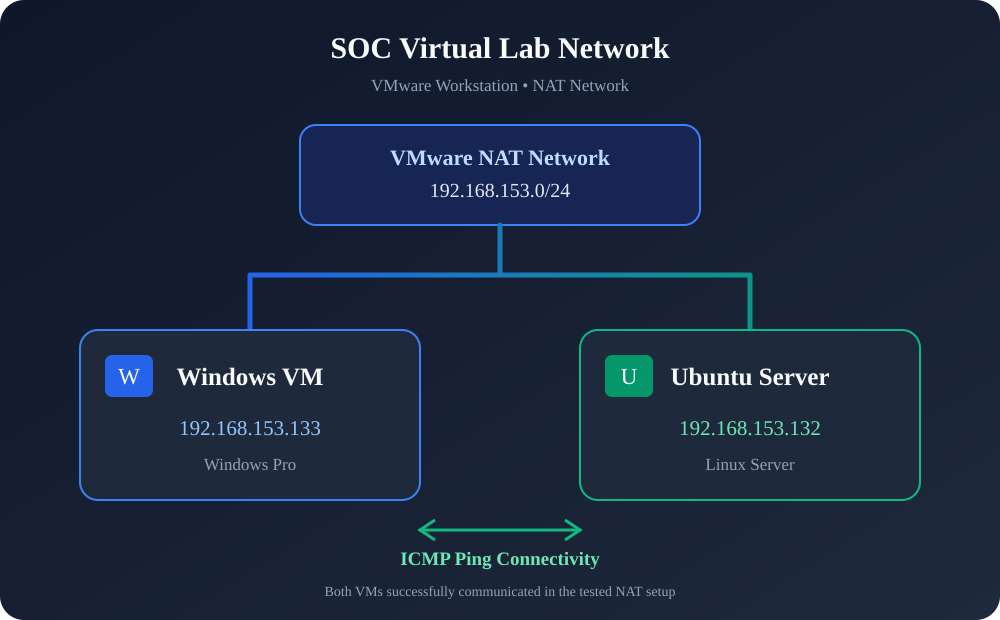
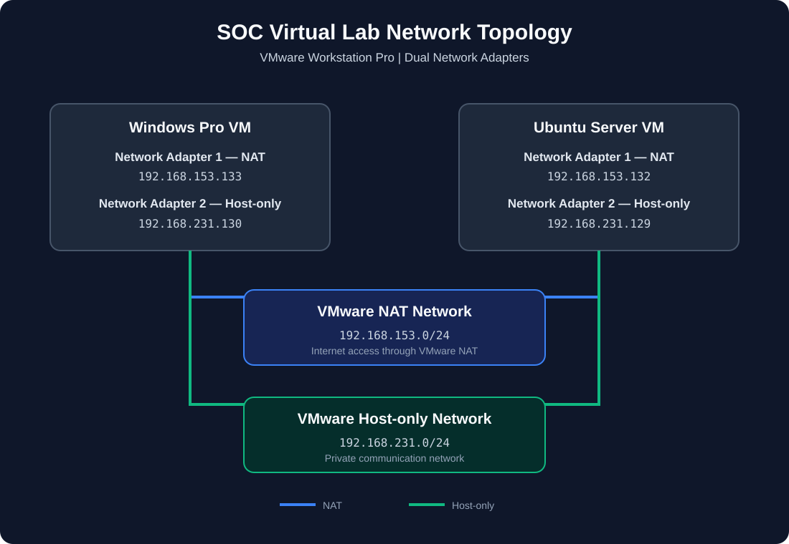

# SOC Virtual Lab Setup

## 1. Lab Overview

A virtual lab was created using VMware Workstation to practice basic SOC operations and network communication between Windows and Ubuntu Server.

The lab uses two network adapters on each virtual machine:

- NAT: Provides internet connectivity.
- Host-only: Provides private communication between the virtual machines.

## 2. Lab Environment

| Component | Configuration |
|---|---|
| Virtualization Platform | VMware Workstation Pro |
| Machine 1 | Windows Pro |
| Machine 2 | Ubuntu Server |
| Network Adapters | NAT + Host-only |
| NAT Network | 192.168.153.0/24 |
| Host-only Network | 192.168.231.0/24 |
| Host-only DHCP | Enabled |

## 3. Virtual Machines

### Windows VM

- Operating System: Windows Pro
- NAT IP Address: `192.168.153.133`
- Host-only IP Address: `192.168.231.130`
- Snapshot: Clean Snapshot Created

### Ubuntu Server VM

- Operating System: Ubuntu Server
- NAT IP Address: `192.168.153.132`
- Host-only IP Address: `192.168.231.129`
- Snapshot: Clean Snapshot Created

## 4. Network Configuration

Both virtual machines have two network adapters configured.

### NAT Network

NAT allows the virtual machines to access external networks through VMware's NAT gateway.

- Network: `192.168.153.0/24`
- Windows: `192.168.153.133`
- Ubuntu: `192.168.153.132`

### Host-only Network

Host-only creates a private network that allows communication between the virtual machines and the host machine without directly exposing the virtual machines to the external network.

- Network: `192.168.231.0/24`
- Windows: `192.168.231.130`
- Ubuntu: `192.168.231.129`

## 5. Network Connectivity Tests

Connectivity was tested using ICMP Echo Requests with the `ping` command.

### NAT Connectivity

**Windows to Ubuntu**

```cmd
ping 192.168.153.132
```

Result:
- Packets Sent: 4
- Packets Received: 4
- Packet Loss: 0%

Status: Successful

**Ubuntu to Windows**

```bash
ping -c 4 192.168.153.133
```

Status: Successful

### Host-only Connectivity

**Windows to Ubuntu**

```cmd
ping 192.168.231.129
```

Result:
- Packets Sent: 4
- Packets Received: 4
- Packet Loss: 0%

Status: Successful

**Ubuntu to Windows**

```bash
ping -c 4 192.168.231.130
```

Result:
- Packets Sent: 4
- Packets Received: 4
- Packet Loss: 0%

Status: Successful

## 6. Network Diagram

### Actual Lab Network Topology



### How NAT Networking Works



*Illustrative diagram explaining the general NAT networking concept. It is not a screenshot of the actual VMware configuration.*

## 7. Snapshots

Clean snapshots were created for both virtual machines to provide a baseline state for future lab exercises.

- Windows: Clean Snapshot
- Ubuntu Server: Clean Snapshot

## 8. Key Learning Outcomes

- Created a virtual lab using VMware Workstation Pro.
- Configured NAT and Host-only network adapters.
- Identified IP addresses using Windows and Linux commands.
- Understood the difference between NAT and Host-only networking.
- Used `ping` to test network connectivity.
- Understood basic ICMP Echo Request and Echo Reply communication.
- Verified communication between Windows and Ubuntu in both directions.

## 9. Conclusion

The SOC virtual lab was successfully configured using VMware Workstation Pro.

Both Windows and Ubuntu Server communicate successfully over NAT and Host-only networks. Connectivity was verified in both directions using ICMP ping tests with 0% packet loss.
